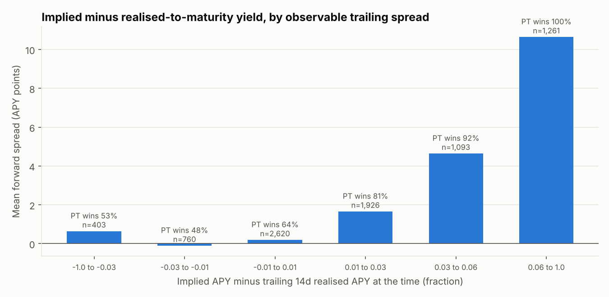
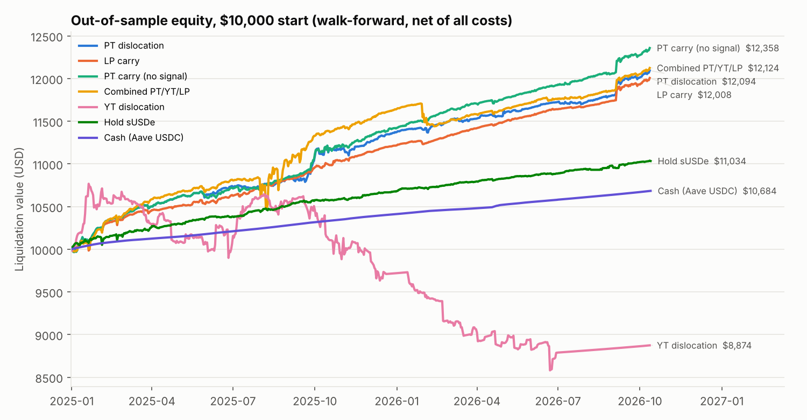
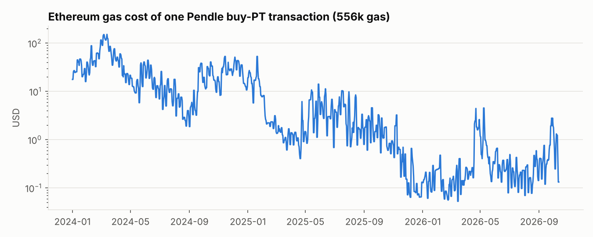
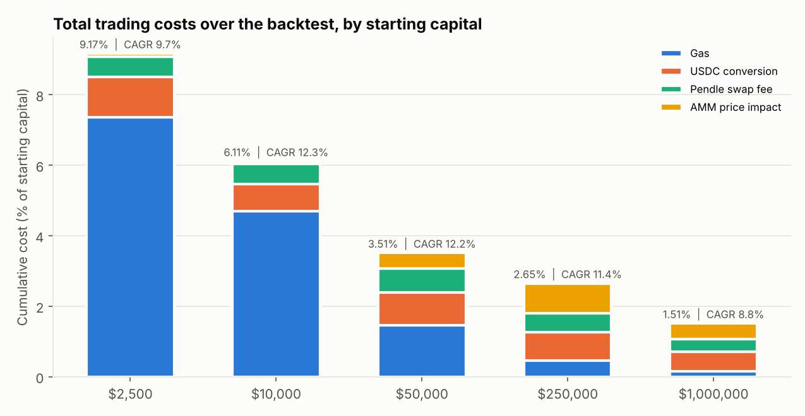

# Results: Pendle fixed vs floating yield dislocations, $10,000 portfolio

* **Universe**: 317 Pendle stablecoin markets (expired and live) on Ethereum and
  Arbitrum. The backtest runs 2024-01-01 to 2026-10-12 (2.8 years).
* **Out-of-sample (OOS) window**: 2025-01-01 to 2026-10-12 (21 months), from an
  expanding-window walk-forward. Parameters are re-chosen every 6 months using
  only prior data.
* **Equity** is liquidation value: what exiting every position that day would
  return after Pendle swap fee, AMM price impact, gas and USDC conversion.
* Methodology and cost sources are in [README.md](README.md).

## 1. Is there a dislocation to trade?

Implied APY was compared with the yield the SY actually delivered from that day to
maturity. The sample is 8,087 market-days on 87 yield-bearing markets with at
least $1M liquidity and at least 14 days to expiry.

| Implied − trailing 14d realised (observable) | Market-days | Mean (implied − realised to maturity) | PT beat floating |
|---|---:|---:|---:|
| below −3% | 403 | +0.6% | 53% |
| −3% to −1% | 760 | −0.1% | 48% |
| −1% to +1% | 2,620 | +0.2% | 64% |
| +1% to +3% | 1,926 | +1.7% | 81% |
| +3% to +6% | 1,093 | +4.6% | 92% |
| above +6% | 1,261 | +10.6% | 100% |

* On average implied APY exceeded the yield later realised by **2.8 points**
  (median 1.7). Fixed beat floating 75% of the time.
* The relationship is monotonic. The more implied sits above trailing realised
  yield, the more PT out-earns the floating leg. **This is the tradable edge.**
* The opposite side has no edge. When implied sits *below* trailing yield (the
  YT entry signal), the forward spread is about zero and the hit rate is a coin
  flip, because floating yields mean-revert down about as often as implied
  catches up.

## 2. Out-of-sample performance, $10,000 start

| Strategy (walk-forward OOS) | Return | CAGR | Max drawdown |
|---|---:|---:|---:|
| PT carry, no signal (control) | +23.6% | 12.6% | −1.1% |
| Combined PT/YT/LP | +21.2% | 11.4% | −3.4% |
| **PT dislocation** | **+20.9%** | **11.3%** | **−1.1%** |
| LP carry | +20.1% | 10.8% | −1.4% |
| Hold sUSDe (floating benchmark) | +10.3% | 5.7% | −1.0% |
| Cash in Aave v3 USDC | +6.8% | 3.8% | 0.0% |
| YT dislocation | −11.3% | −6.5% | −20.3% |

A single walk-forward path depends on which of several near-tied parameter sets
gets picked. The table below shows the OOS-window return of **every** parameter
set tried in each family, which is a better read on robustness. These are not
tradable as such, since you would not know in advance which set to run.

| Family | Sets | Median | 10th pct | Worst | Worst drawdown | Beat sUSDe |
|---|---:|---:|---:|---:|---:|---:|
| PT dislocation | 140 | +20.9% | +18.4% | +16.2% | **−2.2%** | 100% |
| PT carry, no signal | 72 | +22.1% | +20.6% | +15.2% | −6.7% | 100% |
| Combined PT/YT/LP | 110 | +20.7% | +17.1% | +10.4% | −9.7% | 100% |
| LP carry | 90 | +15.6% | +10.6% | +9.8% | −2.9% | 94% |
| YT dislocation | 70 | −6.8% | −42.6% | −61.4% | −66.4% | 1% |

**Reading this honestly:**
* Almost all of the return is **carry**: Pendle fixed rates on stablecoins
  were systematically above what the floating leg later paid. Every PT and LP
  parameter set beat cash, and every PT set beat holding sUSDe.
* The **dislocation filter does not add return** over plain carry in this
  sample. What it adds is protection: its worst parameter set drew down 2.2%,
  against 6.7% for unfiltered carry. That gap is the vyUSD vault loss described
  in section 5, which the unfiltered strategy walked into by chasing the highest
  quoted yield.
* **YT dislocation loses money** in nearly every configuration. Buying even
  $1-3k of YT sells $30-140k of PT notional into the pool. Entry fee plus impact
  alone ran 2.5-17% of the YT purchase in the trade logs, and the trailing-yield
  signal does not predict floating yield well enough to pay for it.
* Sharpe ratios come out at 4-5 because PTs held to maturity mark smoothly.
  They understate the real risk, which is jump risk (depeg or default). Use the
  drawdowns and section 5 instead.

## 3. Recommended configuration: PT dislocation

This is the most recent walk-forward selection, trained on 2024-01 to 2026-06.

| Rule | Value |
|---|---|
| Floating forecast | 30-day half-life EMA of the SY's realised yield |
| Achievable floating yield | max(own forecast, Aave USDC rate smoothed with a 14-day half-life EMA) |
| Enter PT when | all-in fixed APY (after entry and expected exit costs) ≥ achievable + **1%**, and ≥ cash + **2%** |
| Exit early when | remaining hold-to-maturity yield (after exit costs) < achievable yield |
| Otherwise | hold to maturity, redeem, re-deploy |
| Universe | pool liquidity ≥ $1M, ≥ 60 days to expiry at entry, ≥ 14 days of yield history |
| Sizing | ≤ 50% of NAV per market and per SY, ≤ 2% of pool TVL, ≤ 40 bps rate impact |

Full period on $10,000 (partly in-sample, 2024-01 to 2026-10): **+38.1%
(12.3% CAGR), max drawdown −1.8%**. Over the same span Aave cash made +14.4%
(5.0% CAGR) and sUSDe made +23.6% (7.9% CAGR).

* 22 PT purchases across 17 markets (19 on Ethereum, 3 on Arbitrum), held a
  median of 85 days. 18 were redeemed at maturity and 2 sold early. All closed
  trades were profitable. Average entry implied was 14.9%, and the strategy was
  on average 89% invested.
* Markets used: sUSDe, USDe, eUSDe, srUSDe, jrUSDe, KUSDe, USDS, sDAI, gDAI,
  scrvUSD, dUSDC, lvlUSD, USDf, reUSD, mEDGE, SIERRA, USD3. Full log:
  [`results/recommended_trades.csv`](results/recommended_trades.csv).

### Where the costs went ($10,000, 2.8 years)

| Cost | USD | % of starting capital |
|---|---:|---:|
| Gas (Ethereum, measured) | $469 | 4.7% |
| USDC ↔ underlying conversion | $78 | 0.8% |
| Pendle swap fee | $56 | 0.6% |
| AMM price impact | $8 | 0.1% |
| **Total** | **$611** | **6.1%** |

Gas is the dominant cost at this size. One Pendle buy (about 556k gas) typically
cost $5-50 through 2024 (over $100 at the March 2024 peak) and mostly under $1
since December 2025. Price impact is negligible
at $10k because entries are capped at 2% of pool liquidity.

| Starting capital | Full-period CAGR | Total costs | Main drag |
|---:|---:|---:|---|
| $2,500 | 9.7% | 9.2% | gas (7.4%) |
| **$10,000** | **12.3%** | **6.1%** | gas |
| $50,000 | 12.2% | 3.5% | balanced |
| $250,000 | 11.4% | 2.7% | price impact |
| $1,000,000 | 8.8% | 1.5% | capacity: size caps leave capital idle |

$10k-50k is the sweet spot. Below that, gas eats the edge. Above about $250k,
pool depth limits how much can be deployed.

## 4. Stress tests (recommended configuration)

| Scenario | Full-period CAGR | OOS-window CAGR | Max drawdown |
|---|---:|---:|---:|
| Base | 12.3% | 11.6% | −1.8% |
| Gas ×2 | 10.1% | 11.0% | −4.5% |
| Conversion slippage ×2 | 12.4% | 11.6% | −1.8% |
| Gas ×2 and conversion ×2 | 10.5% | 11.1% | −4.6% |
| Trade on yesterday's signal | 12.3% | 11.6% | −1.8% |
| Ethereum only | 11.8% | 11.6% | −2.6% |
| Core underlyings only (> $25M total on Pendle) | 11.1% | 11.1% | −2.1% |

Risk-capped variants. These are constraints added on top, not optimised:

| Variant | Full-period CAGR | Max drawdown | OOS return |
|---|---:|---:|---:|
| As selected (50% per market) | 12.3% | −1.8% | +21.6% |
| Max 25% per market | 10.2% | −3.9% | +20.1% |
| Core underlyings only | 11.1% | −2.1% | +20.6% |
| **25% per market + core only** | **9.6%** | **−2.9%** | **+18.5%** |

## 5. The risks you listed, as they showed up in the data

* **Smart-contract / credit risk (the big one).** On 2025-11-19 the vyUSD vault's
  share value fell 13.6% overnight (likely related to the November 2025
  synthetic-dollar contagion after Stream Finance's xUSD loss; not verified). Pendle's PY index does not fall, so PT holders absorb the
  loss at redemption. The no-signal strategy held that PT and lost $570 on a
  $5.9k position. Pendle's own API kept pricing that PT near par, so a backtest
  built on API PT prices alone would have missed the loss. This engine values
  redemptions off the SY's real exchange rate and caught it. Pendle's API also
  omits some delisted markets (e.g. Elixir deUSD), so collapses are
  **under-represented** here. With up to 50% in one market, a single total
  default costs up to half the book. That is roughly 7 years of the
  strategy's excess return over cash. **For real capital, use the 25%-per-market +
  core-only variant**, which costs about 2.7 points of CAGR.
* **Liquidity depth.** During the Dec 2024 funding spike the sUSDe and USDe
  Mar-2025 pools reached Pendle's 96% PT cap and could not absorb further PT
  sells. The engine marks such
  positions at discounted hold-to-maturity value. Capacity is limited: see the
  capital table above.
* **Yield mean reversion.** This is what makes PT win and YT lose. Floating
  yields on synthetic dollars (Ethena-style funding) mostly compressed after
  entry, so locked fixed rates beat realised rates. A regime of persistently
  rising funding would reverse that.
* **Maturity risk.** Near expiry, pools thin out and the AMM pays below par.
  That is why equity curves step up at maturities, when positions redeem at
  par. The strategy holds through instead of selling into this.

## 6. Limitations

* Points, external SY reward tokens and limit-order fills are not credited. This
  is conservative for YT and LP.
* Our own trades do not persist into the next day's pool state, which is why
  trades are capped at 2% of pool TVL.
* Conversion costs use today's aggregator liquidity, with a 25 bps default
  where no route exists today.
* The OOS window (2025-2026) was a broadly favourable regime for fixed-rate
  carry on stablecoins. Treat the returns as regime-dependent, not as a forecast.

Raw outputs: [`results/summary.json`](results/summary.json),
[`results/oos_equity.csv`](results/oos_equity.csv), per-family search results
`results/search_*.csv`.
